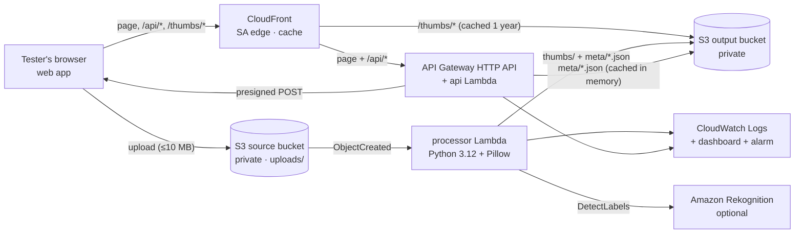

# RekogNail

_Formerly **SmartThumb SA**, the name used in the original project proposal._

Serverless product-photo thumbnails with AI-suggested labels for South African small businesses.
A seller uploads a product photo; an S3 event triggers a Python Lambda that validates it, makes a
≤300×300 thumbnail (aspect ratio kept), optionally asks Amazon Rekognition for labels, and stores
the thumbnail + a JSON result in a separate private bucket. Everything is logged to CloudWatch.

A small web app on a live URL is the **test harness** for the team: upload, see results,
browse everyone's results, watch live logs and run the FR1–FR7 acceptance suite.

## Architecture



| Service | Responsibility |
|---|---|
| Amazon S3 | Private source bucket (originals) and output bucket (thumbnails + `meta/*.json`). Separate buckets make a recursive trigger impossible. |
| AWS Lambda `processor` | Validates by *content* (not extension), applies EXIF rotation, resizes with Pillow, writes results. One bad file never fails the batch. |
| Amazon Rekognition | `DetectLabels` (max 10, ≥70% confidence). Labels are suggestions only. Toggle: `enable_labels`. |
| AWS Lambda `api` + API Gateway | Serves the web app, issues size-limited presigned uploads, lists results (paged, with an in-memory cache of result files), records label votes, reads logs. Protected by a shared team code + throttling. |
| Amazon CloudFront | One HTTPS address with edges in Johannesburg and Cape Town. Caches thumbnails (1 year) and the page (60 s), compresses responses, and keeps warm connections to Ireland for API calls. |
| AWS IAM | One least-privilege role per function, scoped to bucket prefixes and log groups. |
| Amazon CloudWatch | Structured JSON logs (14-day retention), dashboard, error alarm, optional budget alert. |

## Deploy (team lead, once)

Prereqs: Terraform ≥ 1.10, Python 3.12, AWS CLI v2 logged in to the team account (`aws login` or `aws configure sso`), region **eu-west-1**.

```bash
make setup          # local venv for tests/scripts
make bootstrap      # once per account: shared Terraform state bucket -> infra/backend.hcl (commit it)
make init
make deploy         # runs tests, builds the Pillow layer, terraform apply; prints URL + team code
```

Optional settings in `infra/terraform.tfvars` (git-ignored):

```hcl
enable_labels = true                 # Rekognition on/off
budget_email  = "you@example.com"    # monthly budget alert
team_code     = "pick-something"     # otherwise one is generated: make code
```

### Continuous deployment (GitHub Actions)

Every push to `main` runs `.github/workflows/deploy.yml`: unit tests → Pillow layer build →
`terraform plan` → `terraform apply` of exactly that plan → smoke test of the live URL. Pull requests
run the tests only. AWS access uses GitHub OIDC: no AWS keys are stored in GitHub.

One-time setup (admin AWS credentials + `gh` logged in):

```bash
./scripts/bootstrap_ci.sh   # OIDC provider + github-deploy-smartthumb role (main branch only) + repo variable
```

After that, teammates just push to `main` (or open a PR) and never need AWS credentials.
`make deploy` still works locally for anyone with AWS access.

## Test it

**Everyone (no AWS access needed):** open the URL from `make url`, enter your name and the team code.

- **Upload**: drag in photos and see the original next to the thumbnail, size reduction, timing and labels.
- **Gallery**: the latest results from the whole team, with 👍/👎 to rate whether the labels are useful.
- **Logs**: a live CloudWatch tail of both Lambdas, filterable by text or key. "View logs" on any result jumps here.
- **Test suite**: *Run all checks* builds sample files in your browser (landscape, portrait, panorama, transparent PNG, tiny, fake JPEG, corrupt JPEG, .txt) and checks FR1–FR7. Add a real product photo for a meaningful AI-label check.

**From a terminal:**

```bash
make test            # unit tests (Pillow logic, rejection paths, Rekognition failure handling)
make images          # generate test_images/generated (20 files incl. invalid ones)
make batch           # run test_images/** through the live URL -> results/metrics.csv + summary
make logs            # tail processor logs (needs AWS credentials)
```

Put permission-cleared real photos in `test_images/real/` before `make batch`, then fill in the
`label_useful` column (y/n) to score the label-usefulness target.

## Requirements → evidence

| ID | Requirement | How it is verified |
|---|---|---|
| FR1 | Accept image uploads | Test suite + batch: S3 accepts the presigned POST |
| FR2 | Trigger automatically | A result appears with no manual invoke (S3 → Lambda notification) |
| FR3 | ≤300 px, aspect kept | Unit tests + browser loads each thumbnail and checks its real pixel size |
| FR4 | Stored separately | Thumbnail is downloaded from the output bucket |
| FR5 | AI labels | `labels_status: ok`; label chips; team votes |
| FR6 | Log execution | Test suite finds each key's `processed` event in CloudWatch Logs |
| FR7 | Handle invalid files | fake/corrupt/.txt/.gif are `rejected` with a reason, never an unhandled error |

## Results

Measured on the live stack on 22 Oct 2026 (eu-west-1, AI labels on). The data covers all **98 uploads**
in the output bucket from 7 testers: the generated test set (`make batch`), repeated in-browser
test-suite runs, and **12 real photo uploads by teammates** (11 distinct photos: herbal products, cars and
people). Plus 1 empty file that S3 refused before processing.

| Metric | Target | Result |
|---|---|---|
| Valid images processed | ≥ 95% | **100%** (68/68), 0 errors |
| Invalid files handled | all, no crash | **30/30** rejected with a reason: fake JPEG (9), corrupt JPEG (9), .txt (9), .pdf (2), .gif (1). The empty file was refused by S3 before upload |
| Automatic triggering | 100% | **100%**: all 98 uploads were processed with no manual step |
| Avg size reduction | ≥ 50% | **79.7%** across all valid images (median 98.4%); **91.9%** on the real photos |
| Images below 50% | — | **10 of 68**, all already-tiny test images (120×80, 200×150) or the flat transparent logo. **6 got bigger** (up to +17.9%) |
| Thumbnail size | ≤ 300 px, aspect kept | All 68 within bounds. The browser test suite checks real pixel sizes: **7/7 requirements, 8/8 cases**, also through CloudFront |
| Labels rated useful | ≥ 80% | **75% (3 of 4 votes)**: too few votes to judge. Reviewers need to vote on the real photos in the Gallery |
| Processing duration | record baseline | avg **806 ms**, median 579 ms, p95 1,471 ms, max 2,524 ms (1 GB Lambda, including Rekognition) |
| Page and gallery speed (from SA) | — | gallery **8.4 s → 0.44 s**, page **3.1 s → 0.48 s** after caching (see [Speed & caching](#speed--caching)) |
| Upload → visible result | — | about 4–8 s per file in the browser test suite (8 files in parallel, about 20 s total including the CloudWatch log check) |
| Manual time saved | measure, don't assume | **Not measured yet**: time a seller resizing a batch by hand and compare |
| Est. cost per 100 images | calculate | **≈ $0.10** with labels (Rekognition is $0.001 of the ≈ $0.00103 per image); **≈ $0.003** without labels. List prices, Free Tier ignored |

What the labels looked like on the real photos (top labels, as suggested):

| Photo | Suggested labels | Verdict |
|---|---|---|
| ashwagandha-root-powder.jpg | Herbal, Herbs, Plant, Bottle, Cosmetics | relevant |
| calm-chamomile-tea.jpg | Herbal, Herbs, Plant, Flower, Book | mostly relevant ("Book" is wrong) |
| mens-vitality-powder.jpg | Herbal, Herbs, Plant, Astragalus, Flower | relevant |
| AI-generated herbal tin | Cylinder, **Weapon**, Can, Tin, Herbal | mixed; team vote: useful |
| 2022-jeep-wrangler-no-doors.jpeg | Car, Jeep, Transportation, Vehicle, Machine | relevant |
| Aston-Martin-Vanquish.jpg | Machine, Wheel, Tire, Alloy Wheel, Car | relevant but generic |
| g_class.jpg | Transportation, Vehicle, Car, Jeep, Moving Van | relevant ("Moving Van" is wrong) |
| 2_4.png (car wheel) | Machine, Spoke, Alloy Wheel, Car, Car Wheel | relevant; team vote: useful |
| fashion photo (768×960) | Adult, Female, Person, Woman, Hair | describes the model, not the product; team vote: **not useful** |
| fashion photo (768×960) | Person, Hair | describes the model; team vote: useful |

Verdicts without a team vote are our own reading; team votes come from the Gallery.

Rekognition finds the product *category* well for objects (herbal product, car, bag), but sometimes adds wrong
labels ("Weapon" on a tin, "Book" on tea). On fashion photos it labels the *person* rather than the clothing.
Labels are suggestions for a human to review, never facts.

Known behaviour: flat graphics (e.g. a transparent logo PNG) can produce a thumbnail *larger*
than the original, and images already ≤300 px only shrink by re-encoding.

## Speed & caching

Measured from South Africa before caching: page 3.1 s, gallery 8.4 s (about 4 s of it inside the Lambda), each thumbnail 0.8 s and never cached.

| Layer | What is cached | How |
|---|---|---|
| CloudFront edge (Johannesburg/Cape Town) | Thumbnails for 1 year, the page for 60 s | Thumbnails are immutable (unique key per upload, `Cache-Control: immutable`); the page has `max-age=60` and an ETag, so a deploy shows up within a minute |
| Browser | Thumbnails, page | Same headers; thumbnail URLs are now stable, so they are not downloaded again |
| API Lambda memory | Every result file (`meta/*.json`) | Kept between requests while the Lambda is warm, re-downloaded only when its S3 ETag changes (e.g. after a vote) |
| Response size | — | gzip for page and JSON, gallery sends 24 slim cards per page with a server-side summary |

## Security & cost

- Both buckets are private (public access blocked, bucket-owner-enforced, SSE-S3). Originals are only reachable through short-lived presigned URLs.
- Thumbnails are served by CloudFront through Origin Access Control: the bucket policy lets only this distribution read `thumbs/*`. Anyone who has a thumbnail's exact URL can view it (the keys are not listable). Meta files and originals stay private.
- No credentials in code. The Lambdas use IAM roles, and the team code is a Terraform variable or generated value.
- Cost guards: API throttling (10 rps, burst 20), account Lambda concurrency limit, 10 MB upload cap enforced by S3, 14-day object expiry, 14-day log retention, optional budget alert.
- Teardown: `make destroy` removes everything, including bucket contents. The state bucket from `make bootstrap` is kept, so delete it by hand if you no longer need it.

## Limitations / next steps

- The team code is a shared secret, not real user accounts. Next step: Cognito.
- Labels are generic ("Bag", "Accessories"), not brands or materials. Next step: custom labels or a reviewed category mapping.
- No catalogue database. Next step: DynamoDB index plus WhatsApp Business catalogue export.
- Single region. Rekognition is not offered in af-south-1 (Cape Town), so this stack runs in eu-west-1.
