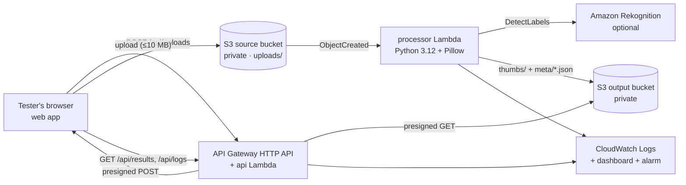

# SmartThumb SA

Serverless product-photo thumbnails with AI-suggested labels for South African small businesses.
A seller uploads a product photo; an S3 event triggers a Python Lambda that validates it, makes a
≤300×300 thumbnail (aspect ratio kept), optionally asks Amazon Rekognition for labels, and stores
the thumbnail + a JSON result in a separate private bucket. Everything is logged to CloudWatch.

A small web app on a live URL is the **test harness** for the team: upload, see results,
browse everyone's results, watch live logs and run the FR1–FR7 acceptance suite.

## Architecture



| Service | Responsibility |
|---|---|
| Amazon S3 | Private source bucket (originals) and output bucket (thumbnails + `meta/*.json`). Separate buckets make a recursive trigger impossible. |
| AWS Lambda `processor` | Validates by *content* (not extension), applies EXIF rotation, resizes with Pillow, writes results. One bad file never fails the batch. |
| Amazon Rekognition | `DetectLabels` (max 10, ≥70% confidence). Labels are suggestions only. Toggle: `enable_labels`. |
| AWS Lambda `api` + API Gateway | Serves the web app, issues size-limited presigned uploads, lists results, records label votes, reads logs. Protected by a shared team code + throttling. |
| AWS IAM | One least-privilege role per function, scoped to bucket prefixes and log groups. |
| Amazon CloudWatch | Structured JSON logs (14-day retention), dashboard, error alarm, optional budget alert. |

## Deploy (team lead, once)

Prereqs: Terraform ≥ 1.10, Python 3.12, AWS CLI v2 logged in to the team account (`aws login` or `aws configure sso`), region **eu-west-1**.

```bash
make setup          # local venv for tests/scripts
make bootstrap      # once per account: shared Terraform state bucket -> infra/backend.hcl (commit it)
make init
make deploy         # runs tests, builds the Pillow layer, terraform apply; prints URL + team code
```

Optional settings in `infra/terraform.tfvars` (git-ignored):

```hcl
enable_labels = true                 # Rekognition on/off
budget_email  = "you@example.com"    # monthly budget alert
team_code     = "pick-something"     # otherwise one is generated: make code
```

### Continuous deployment (GitHub Actions)

Every push to `main` runs `.github/workflows/deploy.yml`: unit tests → Pillow layer build →
`terraform plan` → `terraform apply` of exactly that plan → smoke test of the live URL. Pull requests
run the tests only. AWS access uses GitHub OIDC: no AWS keys are stored in GitHub.

One-time setup (admin AWS credentials + `gh` logged in):

```bash
./scripts/bootstrap_ci.sh   # OIDC provider + github-deploy-smartthumb role (main branch only) + repo variable
```

After that, teammates just push to `main` (or open a PR) and never need AWS credentials.
`make deploy` still works locally for anyone with AWS access.

## Test it

**Everyone (no AWS access needed):** open the URL from `make url`, enter your name and the team code.

- **Upload**: drag in photos and see the original next to the thumbnail, size reduction, timing and labels.
- **Gallery**: the latest results from the whole team, with 👍/👎 to rate whether the labels are useful.
- **Logs**: a live CloudWatch tail of both Lambdas, filterable by text or key. "View logs" on any result jumps here.
- **Test suite**: *Run all checks* builds sample files in your browser (landscape, portrait, panorama, transparent PNG, tiny, fake JPEG, corrupt JPEG, .txt) and checks FR1–FR7. Add a real product photo for a meaningful AI-label check.

**From a terminal:**

```bash
make test            # unit tests (Pillow logic, rejection paths, Rekognition failure handling)
make images          # generate test_images/generated (20 files incl. invalid ones)
make batch           # run test_images/** through the live URL -> results/metrics.csv + summary
make logs            # tail processor logs (needs AWS credentials)
```

Put permission-cleared real photos in `test_images/real/` before `make batch`, then fill in the
`label_useful` column (y/n) to score the label-usefulness target.

## Requirements → evidence

| ID | Requirement | How it is verified |
|---|---|---|
| FR1 | Accept image uploads | Test suite + batch: S3 accepts the presigned POST |
| FR2 | Trigger automatically | A result appears with no manual invoke (S3 → Lambda notification) |
| FR3 | ≤300 px, aspect kept | Unit tests + browser loads each thumbnail and checks its real pixel size |
| FR4 | Stored separately | Thumbnail is downloaded from the output bucket |
| FR5 | AI labels | `labels_status: ok`; label chips; team votes |
| FR6 | Log execution | Test suite finds each key's `processed` event in CloudWatch Logs |
| FR7 | Handle invalid files | fake/corrupt/.txt/.gif are `rejected` with a reason, never an unhandled error |

## Results

First live run, 22 Oct 2026: `make batch` on the 20 generated files (15 valid, 5 invalid), with labels on.
Re-run with real product photos in `test_images/real/` before presenting.

| Metric | Target | Result |
|---|---|---|
| Valid images processed | ≥ 95% | **100%** (15/15) |
| Invalid files handled | all, no crash | **5/5** rejected with a reason (fake JPEG, corrupt JPEG, .txt, .gif, empty file refused by S3) |
| Avg size reduction | ≥ 50% | **83.7%** (median 98.8%); transparent logo −17.9%, 200×150 image 8.9% |
| Auto-trigger rate | 100% | **100%**: every upload was processed with no manual step |
| Labels rated useful | ≥ 80% | _pending team votes on real photos_ |
| Lambda duration | baseline | avg **691 ms**, max 1,492 ms (1 GB memory, labels included) |
| Est. cost per 100 images | calculate | **≈ $0.10**, almost all of it Rekognition ($0.001/image); about $0.002 without labels; Free Tier ignored |

AI caveat seen in testing: a synthetic 5000×700 panorama of a bag was labelled "Weapon / Dynamite".
Labels are suggestions for a human to review, not facts.

Known behaviour: flat graphics (e.g. a transparent logo PNG) can produce a thumbnail *larger*
than the original, and images already ≤300 px only shrink by re-encoding.

## Security & cost

- Both buckets are private (public access blocked, bucket-owner-enforced, SSE-S3). Browsers only ever get short-lived presigned URLs.
- No credentials in code. The Lambdas use IAM roles, and the team code is a Terraform variable or generated value.
- Cost guards: API throttling (10 rps, burst 20), account Lambda concurrency limit, 10 MB upload cap enforced by S3, 14-day object expiry, 14-day log retention, optional budget alert.
- Teardown: `make destroy` removes everything, including bucket contents. The state bucket from `make bootstrap` is kept, so delete it by hand if you no longer need it.

## Limitations / next steps

- The team code is a shared secret, not real user accounts. Next step: Cognito.
- Labels are generic ("Bag", "Accessories"), not brands or materials. Next step: custom labels or a reviewed category mapping.
- No catalogue database. Next step: DynamoDB index plus WhatsApp Business catalogue export.
- Single region. Rekognition is not offered in af-south-1 (Cape Town), so this stack runs in eu-west-1.
